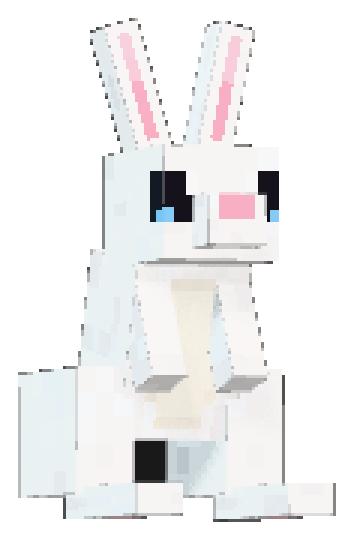
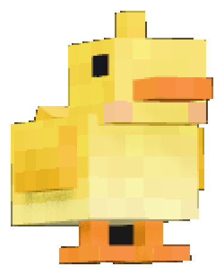
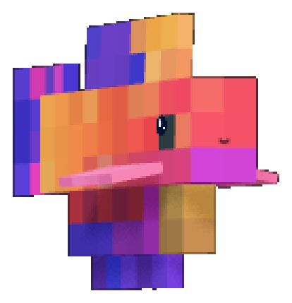
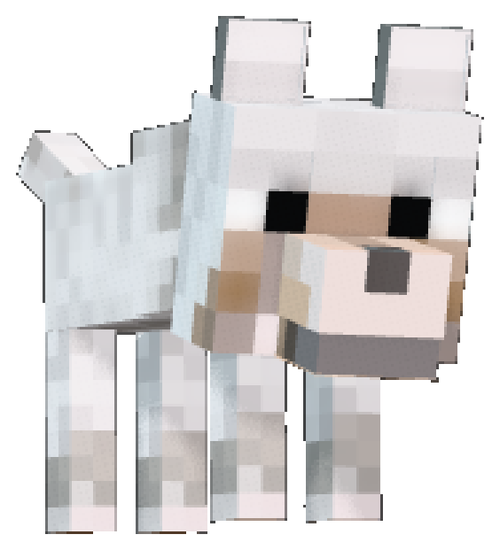
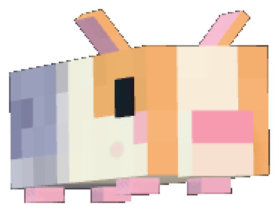

<div align="center">



<br>


<br><br>

[**Meet the pets**](#meet-the-pets) &nbsp;&nbsp; [**Chat**](#chat-with-your-pet) &nbsp;&nbsp; [**Give it a brain**](#give-pockito-a-brain) &nbsp;&nbsp; [**Get started**](#get-started) &nbsp;&nbsp; [**Credits**](#credits)


</div>

## Meet Pockito

Pockito is a desktop pet that lives right on your screen. Pick a pet, let it hang out while you work, and talk to it when you want company or a hint.

Turn on the optional AI and your pet can chat with you and look at a part of your screen **only when you ask**.

<br>

## Meet the pets

Five pets so far. Pick the one that matches your desk.

<table align="center">
  <tr>
    <td align="center" width="190"><br><b>Rabbit</b></td>
    <td align="center" width="190"><br><b>Duckling</b></td>
    <td align="center" width="190"><br><b>Fish</b></td>
    <td align="center" width="190"><br><b>Wolf</b></td>
    <td align="center" width="190"><br><b>Guinea pig</b></td>
  </tr>
</table>

<br>

## Chat with your pet

One bubble floats above your pet and stays put. Type, snap a screenshot, or attach a file. Your pet stays still while it listens.

<div align="center">
  
</div>

<br>

| Button | What it does |
| :---: | :--- |
| 📷 | Drag to select any part of your screen, then ask about it. |
| 📎 | Upload a file and ask about it. |
| ⬆️ | Send your message. |

<br>

## Give Pockito a brain

AI is optional and runs on **free Groq models** with your own key. Nothing is sent until you turn it on and ask.

<div align="center">
  
</div>

<br>

1. **Sign in at Groq.** Open [console.groq.com/keys](https://console.groq.com/keys).
2. **Create a key.** Make a new API key and copy it.
3. **Paste it in Pockito.** Paste the key and press **Save & Continue**.

> [!NOTE]
> Your chats and screen selections are sent to Groq. Your key is encrypted on your computer. You can switch AI on or off from the tray menu, and the saved key stays saved when AI is off. To change it, open the window again and paste a new one.

<br>

## Get started

You need [Node.js](https://nodejs.org) installed.

```bash
git clone https://github.com/AkkhileshCod3s/Pockito.git
cd Pockito
npm install
npm start
```

<br>

## Project layout

```text
Pockito/
├── electron/   desktop shell
├── src/        app code and UI
├── pockito-readme/     pets and artwork
├── build/      packaging resources
├── scripts/    helper scripts
└── .github/    workflows
```

<br>

## Credits

- **Minecraft Wolf (Baby)** by [Matt Alexander](https://sketchfab.com/3d-models/minecraft-wolf-f9181c2d3ea546988187be74173b406b), licensed [CC-BY-4.0](https://creativecommons.org/licenses/by/4.0/).
- **Fish Swimming** (`fish_swimming.glb`). <!-- TODO: add source author and license -->
- **Guinea Pig** (`guinea_pig.glb`). <!-- TODO: add source author and license -->

## License

Released under the [MIT License](LICENSE).

<div align="center">

<br>


Made by [@AkkhileshCod3s](https://github.com/AkkhileshCod3s)

</div>
